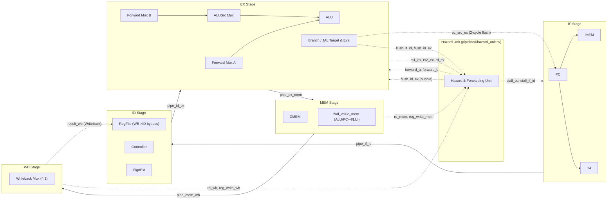
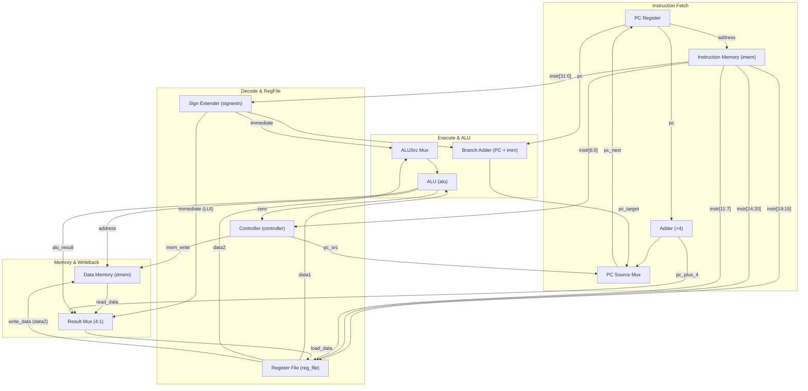

# 5-Stage Pipelined RISC-V (RV32I) Processor

[](https://github.com/nikunjmalik306/riscv-rv32i-5stage-processor/actions/workflows/ci.yml)
[](https://en.wikipedia.org/wiki/SystemVerilog)
[-orange.svg)](https://riscv.org/)
[-brightgreen.svg)](#verification--measured-results)
[](#verification--measured-results)
[](LICENSE)

A synthesizable **5-stage pipelined 32-bit RISC-V (`RV32I`) processor** in SystemVerilog, evolved from a verified single-cycle baseline (`rtl/`) into an `IF → ID → EX → MEM → WB` pipelined microarchitecture (`pipelined/`) with hardware data forwarding, load-use hazard stalling, branch flushing, and differential verification against a Python Instruction Set Simulator (ISS).

---

## Evolution: Single-Cycle Baseline → 5-Stage Pipelined Core

Rather than starting straight from a complex pipeline, this project was structured as an explicit microarchitectural progression:

| Design Dimension | Single-Cycle Baseline ([`rtl/`](rtl/datapath.sv)) | Evolved 5-Stage Pipeline ([`pipelined/`](pipelined/pipe_datapath.sv)) |
| :--- | :--- | :--- |
| **Execution Model** | 1 instruction completes in 1 long combinational cycle (`CPI = 1.00`) | 5 synchronous stages (`IF`, `ID`, `EX`, `MEM`, `WB`) bounded by stage registers |
| **Critical Path** | `PC → IMEM → RegFile → ALU → DMEM → Result Mux → RegFile` | Partitioned into single-stage paths (e.g., EX forwarding + ALU or MEM lookup) |
| **Shared Building Blocks** | `alu`, `controller`, `reg_file`, `signextn`, `imem`, `dmem` | Reuses the exact verified submodules from `rtl/` inside pipeline stages |
| **Data Hazards (RAW)** | None (sequential state updates once per cycle) | `EX/MEM → EX`, `MEM/WB → EX`, `WB → ID` bypass, `x0` suppression, & `LUI`/`JAL` EX/MEM mux (`fwd_value_mem`) |
| **Load-Use Dependency** | Completed within the same clock cycle | 1-cycle stall (`stall_pc`, `stall_if_id`) + EX bubble insertion (`flush_id_ex`) |
| **Control Hazards** | Resolved combinationally before next clock edge | Branches & `jal` resolve in EX; 2-cycle flush (`flush_if_id`, `flush_id_ex`) |
| **Measured Benchmark CPI** | `1.00` (`sum10`: 35 cycles; `mem_loop`: 29 cycles) | `1.60` (`sum10`: 56 cycles / 35 insts); `1.45` (`mem_loop`: 42 cycles / 29 insts) |
| **Differential ISS Fuzzing** | 600 / 600 constrained-random programs (`0` mismatches) | 600 / 600 constrained-random programs (`0` mismatches) |

> [!NOTE]
> All verification was performed using behavioral simulation (Icarus Verilog + Verilator `-Wall` lint + Python ISS) and generic Yosys synthesis; the processor has not been placed and routed on physical FPGA or ASIC silicon.

---

## Evolved 5-Stage Pipelined Microarchitecture (`pipelined/`)

The primary processor implementation in [`pipelined/`](pipelined/README.md) splits instruction execution across five pipeline stages using dedicated synchronous pipeline registers ([`pipe_if_id.sv`](pipelined/pipe_if_id.sv), [`pipe_id_ex.sv`](pipelined/pipe_id_ex.sv), [`pipe_ex_mem.sv`](pipelined/pipe_ex_mem.sv), [`pipe_mem_wb.sv`](pipelined/pipe_mem_wb.sv)) coordinated by [`hazard_unit.sv`](pipelined/hazard_unit.sv).



### Pipeline Hazard & Bypass Mechanisms
- **Priority Forwarding (`EX/MEM` over `MEM/WB`):** [`hazard_unit.sv`](pipelined/hazard_unit.sv) forwards the newest writer (`2'b10` from `EX/MEM`, `2'b01` from `MEM/WB`), while suppressing forwarding when `rd == x0`.
- **`LUI` / `JAL` EX/MEM Value Multiplexing:** In [`pipe_datapath.sv`](pipelined/pipe_datapath.sv), `fwd_value_mem` selects `immediate_mem_fwd` for `lui` and `pc_plus_4_mem_fwd` for `jal` instead of raw `alu_result_mem`, preventing back-to-back RAW corruption on non-ALU results.
- **WB-to-ID Internal Bypass:** Allows an instruction in `ID` to read a register written in `WB` on the same clock edge without stalling.
- **Load-Use Stall & Control Flush:** A load (`result_src_ex == 2'b01`) matching `rs1_id` or `rs2_id` stalls `PC` and `IF/ID` for 1 cycle and injects a bubble into `ID/EX`. Taken branches (`beq`, `bne`) and `jal` resolve in `EX`, flushing `IF/ID` and `ID/EX` (2-cycle penalty).
- **Hardware Performance Counters:** `cycles_count` and `retired_inst_count` measure cycle-accurate CPI directly in hardware.

See [`pipelined/README.md`](pipelined/README.md) for a module-by-module guide.

<details>
<summary><b>Single-Cycle Baseline Reference Architecture (rtl/datapath.sv)</b></summary>



</details>

---

## Supported RV32I Instruction Subset (15 Instructions)

| Class | Instructions | Notes |
| :--- | :--- | :--- |
| **Arithmetic / Logic (R-type)** | `add`, `sub`, `and`, `or`, `slt` | Signed comparison (`$signed`) for `slt`; zero flag output |
| **Immediate ALU (I-type)** | `addi`, `andi`, `ori`, `slti` | 12-bit sign-extended immediates |
| **Upper Immediate (U-type)** | `lui` | Writes `{imm[31:12], 12'b0}` via writeback mux & EX/MEM bypass |
| **Memory Access (Word-Aligned)** | `lw`, `sw` | `address[1:0] == 2'b00` enforced; unaligned/OOB writes ignored |
| **Control Transfer** | `beq`, `bne`, `jal` | Evaluated in EX stage; `jal` writes `pc + 4` to `rd` |

<details>
<summary><b>Controller Truth Tables, Immediate Formats & Memory Rules</b></summary>

### Main Decoder
| Opcode | Class | `reg_write` | `imm_src[2:0]` | `alu_src` | `mem_write` | `result_src[1:0]` | `branch` | `jump` | `alu_op[1:0]` |
|:---:|:---:|:---:|:---:|:---:|:---:|:---:|:---:|:---:|:---:|
| `0000011` | `lw` | `1` | `000` (I) | `1` | `0` | `01` (dmem) | `0` | `0` | `00` |
| `0100011` | `sw` | `0` | `001` (S) | `1` | `1` | `00` (X) | `0` | `0` | `00` |
| `0110011` | R-type | `1` | `000` (X) | `0` | `0` | `00` (alu) | `0` | `0` | `10` |
| `0010011` | I-type ALU | `1` | `000` (I) | `1` | `0` | `00` (alu) | `0` | `0` | `10` |
| `1100011` | `beq`/`bne` | `0` | `010` (B) | `0` | `0` | `00` (X) | `1` | `0` | `01` |
| `1101111` | `jal` | `1` | `011` (J) | `0` | `0` | `10` (PC+4) | `0` | `1` | `00` |
| `0110111` | `lui` | `1` | `100` (U) | `1` | `0` | `11` (imm) | `0` | `0` | `00` |

### Immediate Formats & Memory Addressing
- **Immediates (`rtl/signextn.sv`):** `I = [31:20]`, `S = {[31:25],[11:7]}`, `B = {[31],[7],[30:25],[11:8],1'b0}`, `J = {[31],[19:12],[20],[30:21],1'b0}`, `U = {[31:12],12'b0}`.
- **Memory Bounds (`128` words default):** Unaligned loads return `32'h0`; unaligned/OOB stores are ignored; OOB instruction fetches return `0x00000013` (`NOP`).

</details>

---

## Verification & Measured Results

All suites execute via `make lint && make test`:

| Suite | Target / Tool | Scope & Checks | Result |
| :--- | :--- | :--- | :--- |
| **Verilator Lint** | `datapath` & `pipe_datapath` (`-Wall`) | Static type, width, and latch checks across all `.sv` sources | **0 warnings, 0 errors** |
| **Unit Suites (`tests/unit/`)** | `alu`, `reg_file`, `signextn`, `controller`, `dmem` | 46 self-checking unit assertions | **46 / 46 PASS** |
| **5-Stage Pipeline Hazards** | [`tb_pipeline_hazards.sv`](tests/pipelined/tb_pipeline_hazards.sv) | EX/MEM & MEM/WB forwarding, `x0` suppression, load-use stall, branch flush, `LUI` bypass | **10 / 10 PASS** (35 cyc, 28 retired) |
| **Program Benchmarks** | [`tb_pipeline_programs.sv`](tests/pipelined/tb_pipeline_programs.sv) & [`tb_programs.sv`](tests/integration/tb_programs.sv) | `sum10.hex` ($\sum_{1}^{10}=55$) and `mem_loop.hex` ($\sum=100$) | **PASS** (Pipeline CPI: `1.60`, `1.45`; Single-cycle CPI: `1.00`) |
| **ISS Trace Diff** | [`run_trace_diff.py`](tools/run_trace_diff.py) vs [`rv32i_iss.py`](tools/rv32i_iss.py) | Cycle-by-cycle architectural trace diff on `sum10` & `mem_loop` | **0 mismatches** |
| **Random Differential Fuzz** | [`random_diff_test.py`](tools/random_diff_test.py) | **600** constrained-random programs across **both** cores vs Python ISS | **600 / 600 MATCH** (`0` mismatches) |
| **Generic Synthesis** | Yosys (`make synth`) | `synth -top datapath -flatten` (**94** cells) & `synth -top pipe_datapath -flatten` (**202** cells) | **Clean elaboration** (0 latches) |

---

## Repository Structure

```text
riscv-rv32i-5stage-processor/
├── pipelined/                     # Evolved 5-stage pipelined processor core (primary)
│   ├── README.md                  # Module breakdown, hazard rules & pipeline verification
│   ├── pipe_datapath.sv           # Top-level 5-stage pipeline + WB->ID & LUI/JAL bypasses
│   ├── hazard_unit.sv             # Forwarding, load-use stall & branch flush controller
│   └── pipe_{if_id,id_ex,ex_mem,mem_wb}.sv
├── rtl/                           # Single-cycle baseline & shared verified submodules
│   ├── datapath.sv                # Single-cycle baseline top-level with SVA invariants
│   ├── alu.sv, controller.sv, signextn.sv, reg_file.sv, imem.sv, dmem.sv
│   └── imemory.hex, dmem.hex
├── tests/
│   ├── unit/                      # Standalone module unit testbenches (46 checks)
│   ├── integration/               # Single-cycle baseline integration tests
│   ├── pipelined/                 # 5-stage pipeline hazard & benchmark testbenches
│   ├── random/                    # Random differential test harnesses
│   └── asm/                       # Assembly sources & padded .hex binaries
├── tools/                         # Python RV32I assembler, Golden ISS & differential runner
├── docs/
│   ├── DESIGN_DECISIONS.md        # Architectural rationale & pipeline evolution tradeoffs
│   └── ARCHITECTURE_QA.md         # 25 grounded RTL & microarchitecture Q&As
├── synth/                         # Yosys synthesis script
├── Makefile                       # make all, test, lint, synth, wave, clean
├── CHANGELOG.md                   # Single-cycle -> 5-stage evolution history
└── .github/workflows/ci.yml       # Automated GitHub Actions CI (lint, tests, synthesis)
```

---

## Quick Start

```bash
make lint           # Verilator --lint-only -Wall on single-cycle & pipe_datapath
make test           # Unit tests, pipeline/single-cycle benchmarks, ISS trace-diff & 600 random tests
make test-pipeline  # Run only 5-stage pipeline hazard & program suites
make synth          # Generic Yosys synthesis check
make wave           # Generate VCD waveform dump
```

---

## Limitations & Future Work

- **15-Instruction RV32I Subset:** Implements `lw`, `sw`, `add`, `sub`, `and`, `or`, `slt`, `addi`, `andi`, `ori`, `slti`, `beq`, `bne`, `jal`, `lui`. Shifts (`sll`/`srl`/`sra`), `xor`/`xori`, `sltu`/`sltiu`, remaining branches (`blt`/`bge`/`bltu`/`bgeu`), sub-word loads/stores (`lb`/`lh`/`sb`/`sh`), `auipc`, and `jalr` are not implemented.
- **No CSRs, Traps, or Interrupts:** Runs in unprivileged bare-metal mode without `Zicsr` registers (`mstatus`, `mepc`, `mtvec`), `ecall`/`ebreak`, or misaligned-access trap handlers (unaligned memory accesses are safely ignored/zeroed).
- **Static Not-Taken Branch Prediction:** Branches and `jal` resolve in the EX stage, incurring a 2-cycle flush penalty when taken.
- **Behavioral Memory & Generic Synthesis Scope:** Split Harvard memories (`imem`/`dmem`) are `$readmemh`-initialized arrays without caches or an external AXI/Wishbone bus; during `synth -flatten` in `make synth`, top-level `pipe_datapath` only exposes performance counters (`cycles_count`, `retired_inst_count`), causing Yosys to constant-fold static ROM logic (`202` cells) rather than representing a full physical ASIC/FPGA netlist.
- **Future Work:** Expand ALU/decoder to all 37 base RV32I instructions (including shifts, sub-word accesses, `auipc`, `jalr`), add early ID-stage branch resolution or a 2-bit BHT/BTB predictor, attach L1 caches over a standard bus, and run FPGA/ASIC physical timing analysis.

---

<p align="center">
  <b>5-Stage Pipelined RISC-V (RV32I) Processor</b> • Engineering & Verification by <a href="https://github.com/nikunjmalik306">Nikunj Malik</a>
</p>
